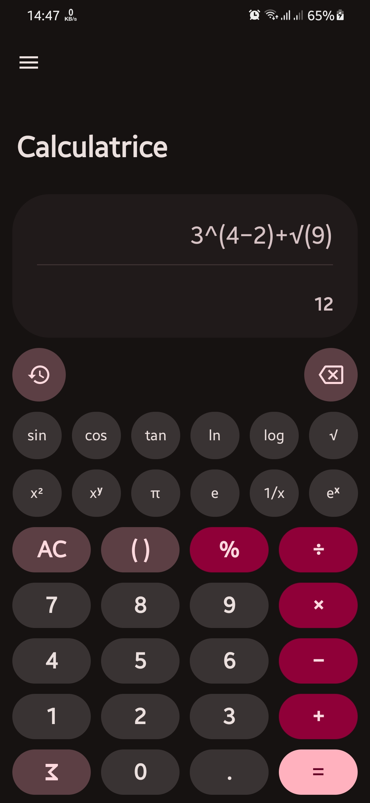
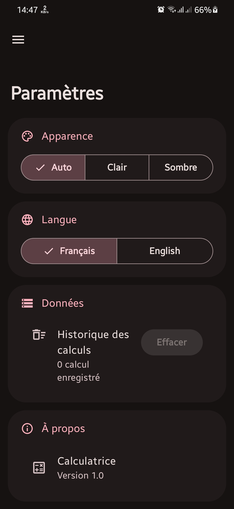
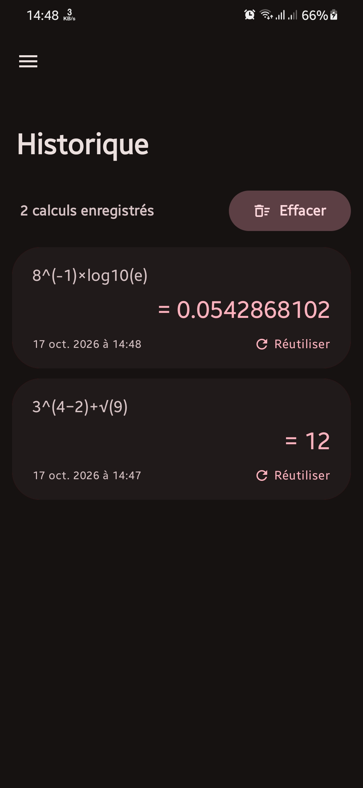
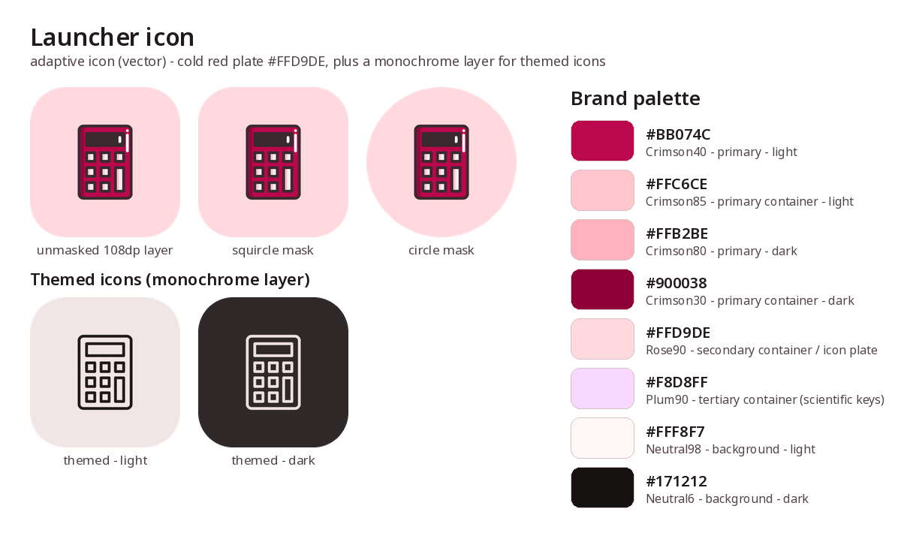

# Calculatrice

A small, fast Android calculator built with Jetpack Compose and Material 3. Live results while you
type, a scientific keypad, a saved history, French and English — all wrapped in a cold-red palette.


<p align="center">
  
  &nbsp;&nbsp;
  
  &nbsp;&nbsp;
  
</p>

## Features

- **Live preview** — every keystroke is evaluated as you type; the running result previews under the
  expression and flips to the accent colour once you press `=`.
- **Scientific keypad** — a two-row strip with `sin` `cos` `tan` `ln` `log` `√`, `x²` `xʸ` `π` `e`
  `1/x` `eˣ`. The display keeps its minimum height, so it never shrinks away when the strip opens.
- **History** — every result is stored locally with DataStore + Protobuf. Tap an entry to reuse it,
  copy a result to the clipboard, clear the log behind a confirmation dialog.
- **French and English** — switch the language from Settings; the whole UI updates in place, no
  restart.
- **Appearance** — Auto / Light / Dark, on a custom Material 3 crimson scheme, with shapes,
  typography and motion tuned for the brand.
- **Smooth motion** — gradual display size easing, springy key presses and screen transitions from a
  single motion spec (`ui/theme/Motion.kt`).
- **Adaptive launcher icon** — vector foreground, cold-red plate and a monochrome layer for themed
  icons.
- **Small release** — R8 and resource shrinking bring the release APK down to ~2.3 MB.

## Brand

The palette is the "cold red" scale the whole UI is built from — crimson for the accent, rose for
containers, plum for the scientific keys, warm neutrals for surfaces.

<p align="center">
  
</p>

## Tech stack

| Layer       | Choice                                                               |
|-------------|----------------------------------------------------------------------|
| Language    | Kotlin 2.2.10                                                        |
| UI          | Jetpack Compose (BOM 2025.10.01), Material 3                         |
| Navigation  | Navigation Compose                                                   |
| State       | ViewModel + Kotlin Flow                                              |
| Storage     | DataStore + Protobuf (`history.proto`)                               |
| Expressions | [exp4j](https://www.objecthunter.net/exp4j/)                         |
| Build       | AGP 9.4.1, Gradle 9.6, version catalog (`gradle/libs.versions.toml`) |
| Tests       | JUnit4 (engine + layout), Compose UI test                            |
| SDK         | min 28, target/compile 37, JDK 21                                    |

## Getting started

Requirements: JDK 21, Android SDK with platform 37 and build-tools 36.0.0.

```bash
./gradlew :app:assembleDebug               # debug APK
./gradlew :app:installDebug                # install on a connected device
./gradlew :app:testDebugUnitTest           # 18 unit tests (engine + layout)
./gradlew :app:connectedDebugAndroidTest   # instrumentation test (device or emulator)
./gradlew :app:assembleRelease             # minified + resource-shrunk release APK
```

The release build is not signed yet — add your own keystore before publishing to Play.

## Notes

The screenshots above are rendered from the app's real theme and layout values (`ui/theme/Color.kt`,
`CalculatorScreen.kt`); they live in `docs/screenshots/` and can be swapped for device captures at
any time.

---

Made by [brahimlakhal3](https://github.com/brahimlakhal3).
